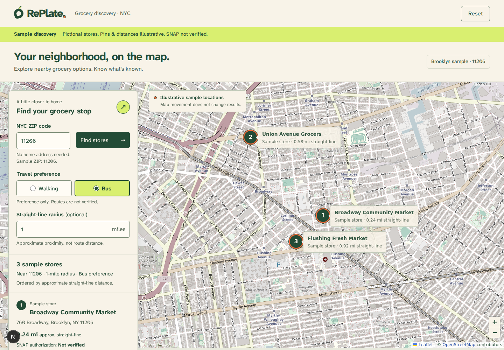
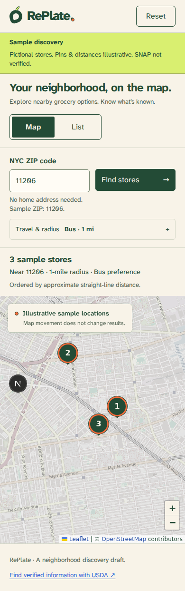

# Discovery screen review — October 9, 2026

The user approved the first development-only discovery screen through Q1–Q8 and then approved the recommended Motion addition. The root `inspiration.png` is the sole visual reference. Its map-dominant canvas, inset panel, numbered pins, compact callouts, and selected detail treatment informed the screen; commerce navigation, retailer photography, and unsupported store claims were excluded. The full reference analysis is in `REPLATE-DESIGN-DIRECTION.md`.

## Result and refinements

The first complete discovery screen lives at `/prototype`, retaining production gating and noindex. It uses RePlate's cream, forest, tomato, lime, and transit tokens and the locally hosted Atkinson font. Headlines remain exploratory. No supplied produce assets exist in the workspace, so their placement is pending rather than replaced with invented retailer imagery.

Desktop uses a sticky geographic map with an inset search/results panel and ordinary page scrolling. Mobile starts with Map and exposes List plus optional travel/radius controls. Submitted results survive unapplied edits; stable selection connects cards and keyboard-operable pins. Sample directions are disabled, and unknown SNAP, prices, stock, routes, time, and trip fares stay explicit.

Screenshot inspection led to a compact desktop ZIP/action row, collapsed optional mobile controls, responsive refitting of pins, and a mobile summary that grows with enlarged text instead of clipping. Motion 14.1.0 (MIT) supplies 160ms summary entry/exit, card layout transitions, and the mobile view indicator. `LazyMotion` uses the layout-capable feature set; reduced-motion mode removes the layout movement. Camera changes are immediate.





## Verification evidence

| Check | Result |
| --- | --- |
| `npm test` | Passed: 36 tests, including three new sample-discovery regressions. Required execution outside the sandbox for the existing extraction test's child Node process. |
| `npm run lint` | Passed without errors or warnings. |
| `npm run typecheck` | Passed. |
| `npm run build` | Passed outside the sandbox with native bindings installed by npm. The sandboxed build compiled but could not read its child TypeScript process output. |
| `node scripts/verify-discovery.mjs` with the existing external Playwright installation | Passed. Tile requests were intercepted with deterministic fixtures, without live provider calls. |
| Production generated HTML assertions | Passed: development-only notice and noindex remain; sample retailer results are not rendered in production. |
| CRLF-aware `git diff --check` on affected files | Passed. Preserved the existing manifest/lockfile line-ending convention. |
| Geographic desktop/mobile visual capture | Inspected at 1440 × 1000 and 390 × 844. Real OpenStreetMap tile responses were HTTP 200; no page errors. Observed 37 responses across the desktop capture and mobile refit. |

Browser checks cover sample labeling and disabled directions, draft/applied radius behavior, malformed/unsupported ZIPs, invalid radius, empty-state recovery, travel-preference ordering, card/pin selection, Enter/Space activation without focus theft, selection clearing when excluded, mobile view choice, optional controls, 320px overflow, 200% root text sizing, selected-summary clipping, reduced motion, reset/focus, and tile outage/retry. The initial focused check failed on the old screen's missing map pins; implementation then passed. Keyboard verification exposed a missing Enter handler, which was corrected before the final pass.

Exact browser command in this environment:

```sh
REPLATE_PLAYWRIGHT_MODULE=/tmp/replate-prototype-qa/node_modules/playwright/index.mjs \
PLAYWRIGHT_BROWSERS_PATH=/tmp/replate-prototype-browsers \
LD_LIBRARY_PATH=/tmp/replate-prototype-browser-libs/extracted/usr/lib/x86_64-linux-gnu \
node scripts/verify-discovery.mjs
```

The optional script creates screenshots under `/tmp/replate-discovery` by default. It accepts `REPLATE_BASE_URL` and `REPLATE_SCREENSHOT_DIR`. Playwright is not a new repository dependency. Chromium and the local development server required sandbox escalation. Initial startup used `npm run dev -- --webpack` because native Linux Next bindings were absent; the approved npm install also restored those optional bindings. `WATCHPACK_POLLING=true` was used for reliable source updates on the Windows-mounted workspace. Conflicting old development cache files were moved aside, not deleted. The automatically added AGENTS block was removed through Next's own generator after stopping the development server; repository instructions were preserved.

## Remaining verification and release boundaries

- No desktop/mobile screen-reader combination or five-shopper study was run. This is not a WCAG conformance claim.
- The 320px viewport and doubled root font exercise reflow/text enlargement; actual 400% browser zoom remains untested.
- LCP/INP/CLS field targets, throttled representative-device performance, animation/map bundle contribution, and interaction latency remain unmeasured. Request count alone is not a performance gate.
- No live retailer records, authorization evidence, geocoding, routes, fare calculation, prices, or inventory were integrated or verified. Coordinates and fixture distances are independently illustrative.
- The MTA education link was reachable. The retained USDA locator URL returned HTTP 403 to automated browsing, so its current destination behavior remains unverified.
- OpenStreetMap provider policy/privacy were reviewed for this development prototype; production suitability and future hosting decisions remain separate.
- Supplied produce artwork remains pending. No commits, pushes, or deployment were performed.
- The npm installation reported five high-severity advisories in the resolved dependency tree. Their provenance was not audited as part of this screen work; no unrelated dependency upgrades or forced audit fixes were performed.
