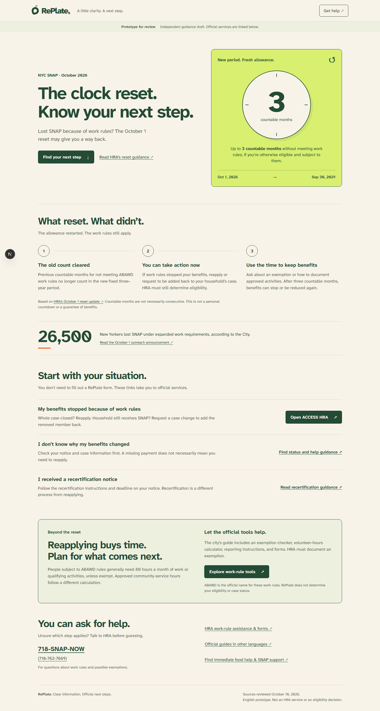
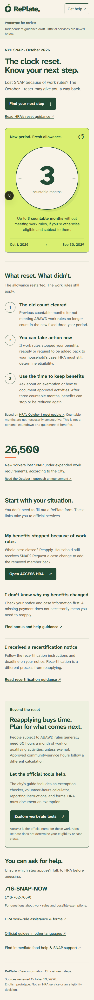

# SNAP awareness prototype review

Historical review of the original draft. The frontend has since been consolidated: Info is at `/`, Explore is at `/explore`, and the old prototype URLs redirect. Development-only gates and prototype framing have been removed. The original verification below is not evidence of the consolidated frontend; see [current behavior and verification commands](../../src/app/explore/README.md).

October 10, 2026. Approved scope: an English, development-only, mobile-friendly infographic with official handoffs. The custom form and grocery planner are deferred to P1. No dependencies were added.

The prototype is at `/prototype/snap`. It preserves RePlate's cream/forest/lime palette, tomato accents, wordmark, and locally hosted Atkinson font. The infographic is HTML text and a CSS clock illustration rather than an image containing essential text. It uses no animation, accounts, forms, uploads, or benefit-status integration. The existing discovery prototype and public homepage were not changed.

## Content evidence

- [HRA's October reset update](https://home4.nyc.gov/site/hra/partners/community-updates.page) establishes the fixed October 1, 2026–September 30, 2029 period and the new three countable months for otherwise eligible people subject to ABAWD rules. The graphic is an allowance illustration, not a live countdown. Months need not be consecutive; neither reapplication nor RePlate guarantees approval.
- [HRA's ABAWD page](https://www.nyc.gov/site/hra/help/able-bodied-adults-without-dependents.page) distinguishes reapplying for a closed case from adding a removed member back to a continuing household. Work rules remain in effect.
- [NYC's work-rule guide](https://www.nyc.gov/main/services/snap-benefits/abawd) is the handoff for exemption screening, volunteer-hour calculation, reporting, and forms. The prototype does not calculate those hours or determine exemptions.
- [NYC's October 1 announcement](https://www.nyc.gov/zh-ch/mayors-office/news/2026/10/mayor-mamdani-launches-citywide-push-to-get-snap-benefits-back-t) supports the attributed approximately 26,500-person impact figure. The national five-million figure is omitted.
- Unknown loss reasons and recertification have separate links to the [general NYC SNAP guide](https://www.nyc.gov/main/services/snap-benefits).

Older PEU flyer recovery prerequisites conflict with the October reset update. They are not reproduced as requirements for the reset. The multilingual resources link is for access to city guides, not a claim that every older flyer reflects the October reset. Detailed recovery instructions and translations need content review before public release.

## Verification

| Check | Result |
| --- | --- |
| `npm test` | Passed: all 48 existing tests. |
| `npm run lint` | Passed, including the new browser-check script. |
| `npm run typecheck` | Passed. |
| `npm run build` | Passed after the final reflow fix. The initial sandboxed build failed on Windows filesystem canonicalization; the same command passed with sandbox escalation. |
| `node scripts/verify-snap.mjs` | Passed against the development server with bundled Playwright. Checks noindex, no forms, official-link hosts, local anchors, keyboard skip link, three distinct help paths, runtime errors, and 320/390px reflow at 100%/200% root text. An initial enlarged-text header overflow was fixed before the passing run. |
| `REPLATE_EXPECT_PRODUCTION=1 node scripts/verify-snap.mjs` | Passed against the local production server: only the development-only notice renders; no official guidance links are exposed and noindex remains. |
| Visual inspection | Desktop at 1440px and phone at 390px; inspected full-page screenshots. |
| Diff whitespace | Passed for the added source, script, and notes. Existing unrelated edits preserved. |

PowerShell browser command (using the installed bundled dependency, without adding a package):

```powershell
$env:REPLATE_PLAYWRIGHT_MODULE='C:\Users\david\.cache\codex-runtimes\codex-primary-runtime\dependencies\node\node_modules\playwright\index.mjs'
$env:REPLATE_BASE_URL='http://localhost:3002'
node scripts/verify-snap.mjs
```

The production check used `http://localhost:3003` and `REPLATE_EXPECT_PRODUCTION=1`. Browser/server execution required sandbox escalation for local sockets. The temporary production server was stopped after verification. Next-generated instruction/type-file changes were removed or restored through Next's generators.




No official application was submitted, no authenticated HRA journey was tested, and no screen-reader or representative-user study was performed. Automated reflow checks do not establish WCAG conformance. Outside review and source reconciliation remain release boundaries; no commit, push, or deployment occurred.
